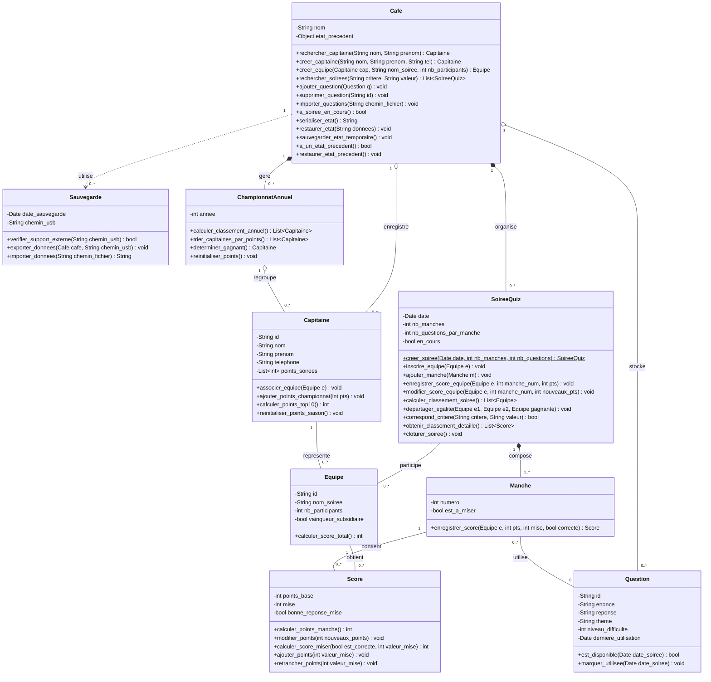

_L’intelligence artificielle a été utilisée comme outil d’assistance pour contribuer à la reformulation de certaines phrases, dans le but d’améliorer la clarté et la cohérence du document._

1. Classe principale Cafe et répartition des responsabilités : Nous avons ajouté la classe Cafe comme point d'entrée principal du programme. Elle permet de centraliser l'accès aux données générales et de gérer les sauvegardes temporaires (F-09). Nous avons également ajouté la classe Sauvegarde, issue de D-06, qui s'occupe de l'exportation et de la restauration des données sur une clé USB. Cependant, nous avons préféré répartir les autres fonctionnalités dans les classes qui leur correspondent, comme SoireeQuiz, Capitaine, Score et ChampionnatAnnuel, plutôt que de tout regrouper dans une seule classe.

2. Séparation entre Capitaine et Equipe : Pour respecter la règle RM-04, qui demande de conserver l'historique même lorsqu'une équipe change de nom, nous avons séparé les classes Capitaine et Equipe. Une Equipe représente une participation à une soirée précise. Elle possède donc un nom temporaire (nom_soiree) ainsi qu'un indicateur permettant de départager les égalités (vainqueur_subsidiaire), conformément à la règle RM-08. Le Capitaine, quant à lui, reste enregistré d'une soirée à l'autre et conserve l'historique de ses points (points_soirees). Ces informations permettent notamment de calculer le Top 10 annuel (RM-12).

3. Compositions, agrégations et dépendances :
- Cafe → SoireeQuiz et ChampionnatAnnuel / SoireeQuiz → Manche : Nous avons utilisé des relations de composition (losange plein), car une soirée et un championnat sont liés au café, tandis qu'une manche dépend directement de la soirée à laquelle elle appartient. Leur existence est donc liée à celle de leur élément parent.
- Cafe → Capitaine et Question / ChampionnatAnnuel → Capitaine : Nous avons utilisé des relations d'agrégation (losange vide), car un capitaine ou une question peuvent exister indépendamment d'un championnat annuel.
- Cafe ..> Sauvegarde : Nous avons utilisé une relation de dépendance pour montrer que la classe Cafe fait appel à Sauvegarde lorsqu'il faut exporter ou restaurer les données.
4. Multiplicités : Nous avons ajouté des multiplicités sur les associations pour préciser combien d'objets peuvent être liés entre eux. Par exemple, chaque Equipe appartient à une seule SoireeQuiz, tandis qu'une soirée peut contenir plusieurs équipes (1 vers 0..*). Une équipe peut également avoir zéro ou plusieurs Score.

5. Répartition des responsabilités : Nous avons attribué les méthodes aux classes en fonction de leur rôle et des informations qu'elles possèdent. Par exemple, calculer_points_top10() se trouve dans Capitaine, calculer_score_miser() dans Score, est_disponible() dans Question et exporter_donnees() dans Sauvegarde. Nous avons également tenu compte des diagrammes de séquence pour garder une bonne cohérence entre les différents diagrammes. Cette organisation permet de mieux répartir le travail entre les classes et d'éviter qu'une seule classe ait trop de responsabilités.
