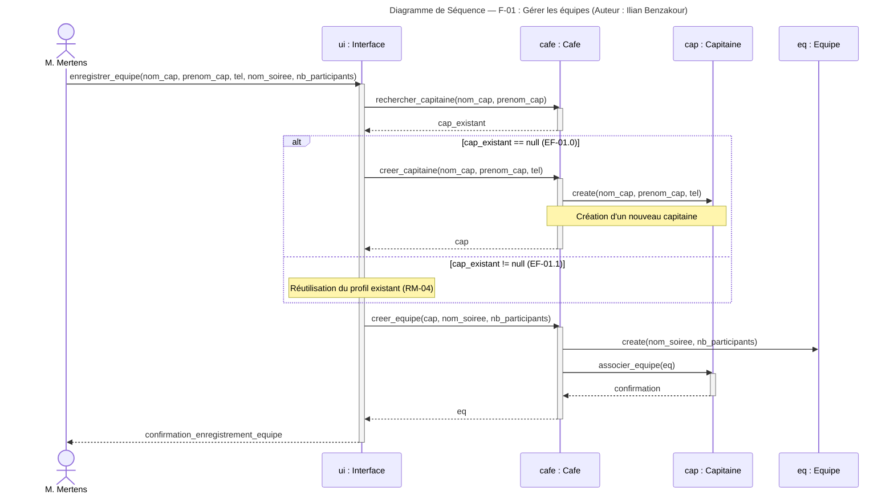
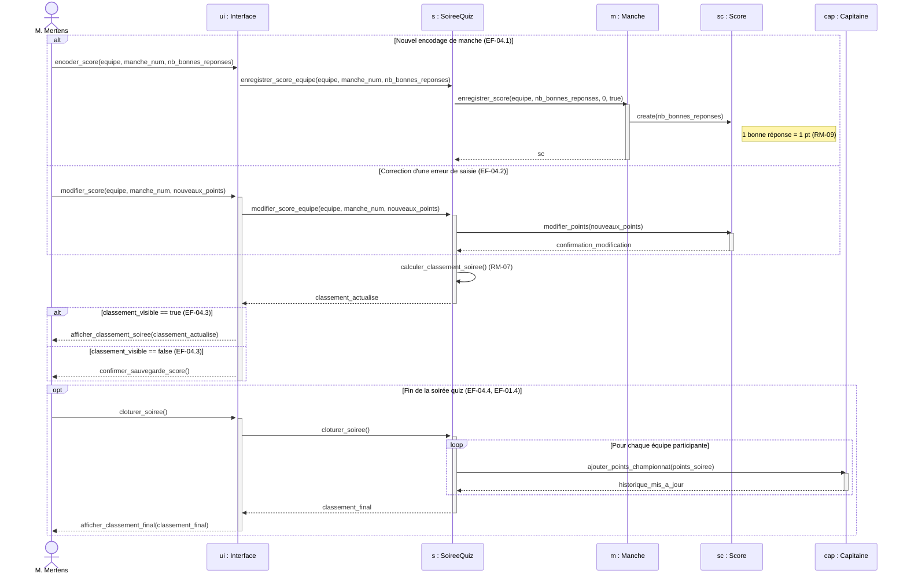
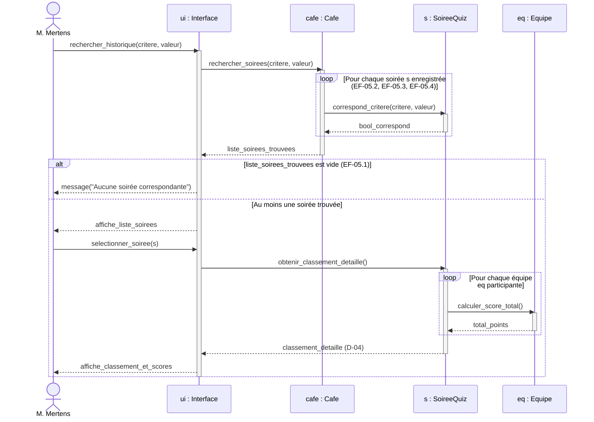
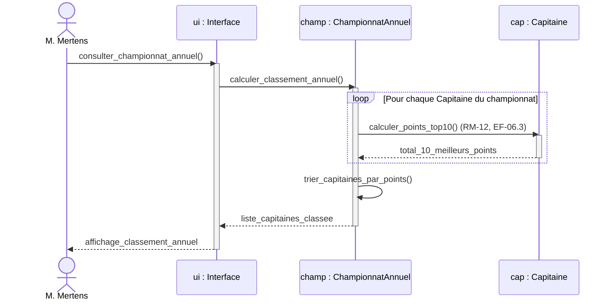
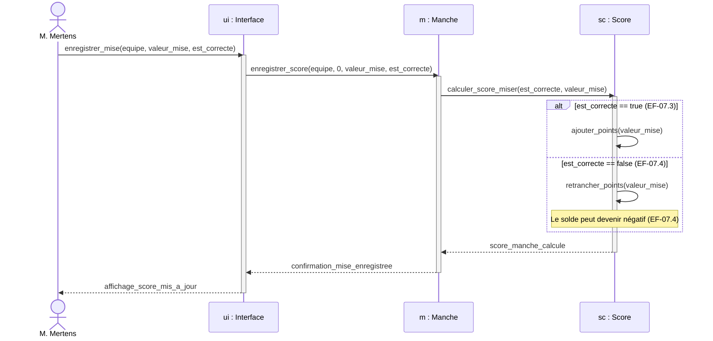
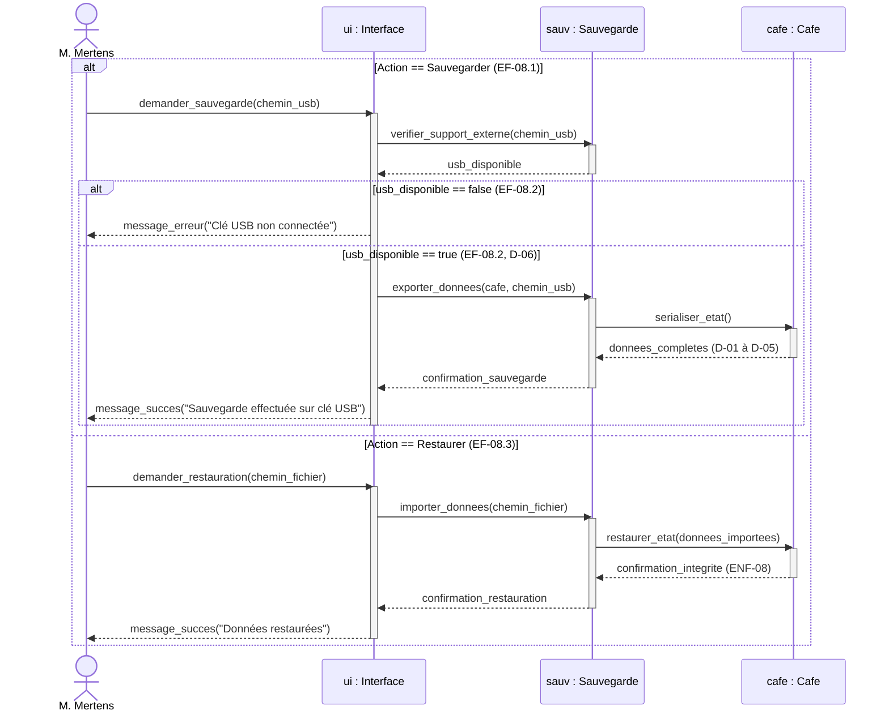
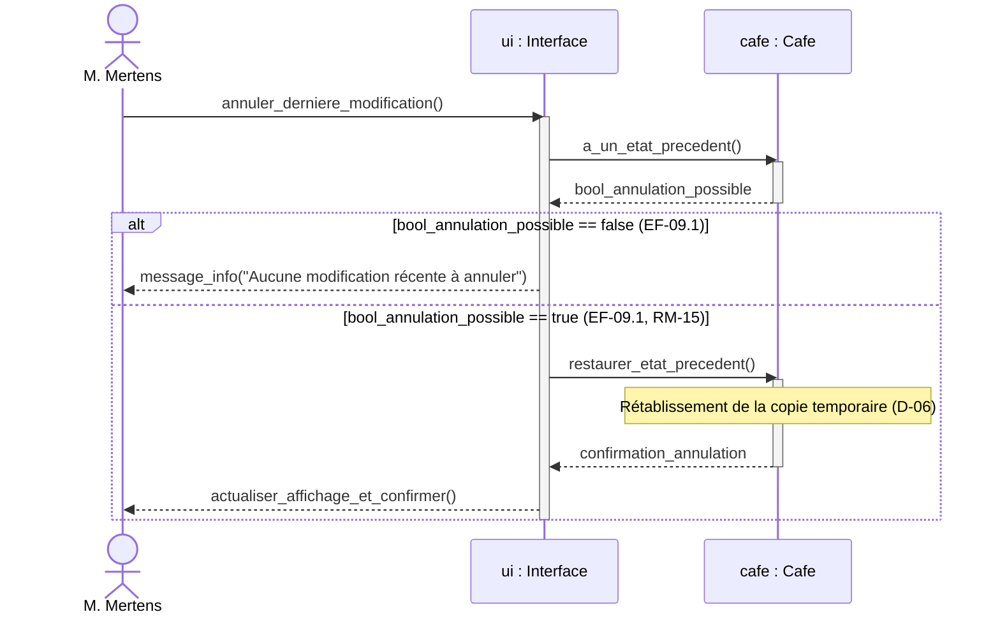

_L’intelligence artificielle a été utilisée comme outil d’assistance pour contribuer à la structuration des diagrammes ainsi qu’à la reformulation de certaines phrases, dans le but d’améliorer la clarté et la cohérence du document._

# Diagramme 1 : Diagramme de Séquence — F-01 : Gérer les équipes

- Différence entre Capitaine et Equipe : Pour respecter la règle RM-04, nous avons séparé les classes Capitaine et Equipe. Le capitaine reste le même au fil des soirées, ce qui permet de conserver son historique. L'équipe, quant à elle, est créée pour chaque soirée et possède un nom temporaire (nom_soiree).

- Gestion des deux possibilités EF-01.0 / EF-01.1 : Le bloc alt/else permet de représenter les deux situations possibles. Si le capitaine n'est pas encore connu du système, un nouveau profil est créé. Par contre, s'il est déjà inscrit, son profil existant est simplement réutilisé. Cela correspond aux deux cas prévus dans la fiche du Use Case.

# Diagramme 2 :  F‐02 — Gérer et importer les questions         (Auteur : Ismail Mehane)

- Ce diagramme représente l'ajout des questions par M.mertens dans la base de données des questions.Le programme vérifie d'abord que aucune partie ne se joue car si une partie est active l'ajoute d'une question est impossible et l'ajout sera refusé(on peut encoder la difficulté de 1 à 3).
- j'ai également séparé les responsabilités entre les classes pour faciliter la gestion des questions.

# Diagramme 3 :  F-03 — Organiser une soirée         (Auteur: Ilian Benzakour)

- Ce diagramme représente la création d'une partie par M.Mertens. Il peut ajuster le nombre de manches, de questions et de manches spéciales. Le programme vérifie si une équipe existe déjà en base de données ou s'il faut en créer une. Le programme fini par créer le partie

# Diagramme 4 :  F-04 - Encoder les scores et résultats

- Respect des lignes de vie du modèle : Nous avons repris uniquement des objets qui existent déjà dans notre diagramme de classes, à savoir SoireeQuiz, Manche, Score et Capitaine. Nous n'avons donc pas ajouté de classe générale comme « Système » ou « Base de données », afin de rester cohérents avec notre modèle.

- Lien avec les exigences de F-04 :
- EF-04.1 et RM-09 : Lorsqu'un score est encodé, une nouvelle instance de Score est créée et associée à la manche ainsi qu'à l'équipe concernée.
- EF-04.2 : Le premier bloc alt représente le cas où un score doit être corrigé. Une fois la modification effectuée, le classement de la soirée est directement recalculé grâce à la méthode calculer_classement_soiree() (RM-07).
- EF-04.3 : Le deuxième bloc alt permet de montrer les deux possibilités : afficher le classement au public ou le garder masqué pendant la soirée. Cette responsabilité est confiée à Interface pour éviter de mélanger la gestion des données avec leur affichage.
- EF-04.4 et EF-01.4 : Le bloc opt représente l'enregistrement des résultats à la fin de la soirée dans l'objet Capitaine. Cela permet de conserver l'historique des résultats, même si le nom de l'équipe change d'une soirée à l'autre, comme demandé dans la règle RM-04.
- Mise à jour du diagramme de classes : En réalisant ce diagramme de séquence, nous avons identifié deux méthodes supplémentaires : modifier_score_equipe(...) dans SoireeQuiz et modifier_points(...) dans Score. Il faudra donc les ajouter au diagramme de classes pour que les deux diagrammes restent cohérents. Cela fait partie de la démarche progressive de conception vue au cours.

# Diagramme 5 :  F-05 - Consulter le classement d'une soirée

- Respect du principe d'expert en information : Nous avons confié la recherche à l'objet SoireeQuiz, qui vérifie si une soirée correspond aux critères demandés. Ces critères peuvent être la date (EF-05.2), l'équipe (EF-05.3) ou le capitaine (EF-05.4). De son côté, chaque objet Equipe calcule lui-même son total de points grâce à la méthode calculer_score_total(). Cela permet de donner chaque responsabilité à la classe qui possède les informations nécessaires.

- Séparation entre l'interface et la logique métier : Nous avons choisi de laisser l'objet Interface s'occuper uniquement des actions de l'utilisateur, comme la sélection des critères et l'affichage des résultats. Le filtrage et le tri des données sont réalisés par les objets du domaine afin de ne pas mélanger l'affichage avec le fonctionnement du programme.

# Diagramme 6 : F-06 Calcul du classement du championnat (Auteur : Florent Chiappelloni)

- **Fragment loop :** Nous avons utilisé un fragment loop pour montrer que le programme répète la même opération pour chaque capitaine enregistré afin de récupérer ses résultats.

- **Application de la règle métier RM-12 :** Le message calculer_points_top10() est envoyé à la classe Capitaine, car c'est elle qui possède l'historique des scores. Il est donc logique que ce soit cette classe qui s'occupe de calculer le total en prenant uniquement les 10 meilleurs résultats de chaque capitaine. Cela permet de respecter la règle métier RM-12.

# Diagramme 7 : F-07 Traitement d'une manche à miser (Auteur : Gildas Kockerols)

- **Gestion des différents cas :** Le fragment alt permet de montrer les deux situations possibles : lorsque le joueur gagne des points ou lorsqu'il en perd. La note explicative précise également que le score peut être négatif, comme indiqué dans l'exigence EF-07.4 et dans le critère d'acceptation de la manche à miser.

- **Responsabilité du calcul :** Nous avons placé la méthode calculer_score_miser dans la classe Score, car c'est cette classe qui est directement liée au résultat obtenu. Cela permet de garder le calcul au bon endroit et d'éviter de répartir cette logique dans plusieurs classes.

# Diagramme 8 : F-08 - Sauvegarder et restaurer les données

- Utilisation de la classe Sauvegarde (D-06) : Nous avons choisi d'utiliser la classe Sauvegarde pour gérer l'importation et l'exportation des données. Elle provient directement de la section D-06 du cahier des charges. Cela permet d'éviter d'ajouter des éléments techniques comme « Système » ou « Système de fichiers » qui ne font pas partie de notre modèle.

- Vérification de la clé USB (EF-08.2) : Le bloc alt avec la condition usb_disponible == false permet de représenter le cas où aucune clé USB n'est détectée. Le programme affiche alors un message d'erreur pour prévenir l'utilisateur. Cette vérification permet de respecter l'exigence EF-08.2.

# Diagramme 9 : F-09 - Annuler la dernière modification

- Gestion de l'historique temporaire (D-06, RM-15) : Nous avons choisi de confier cette responsabilité à l'objet principal Cafe. Avant chaque modification importante, il conserve une copie de l'état précédent grâce à la méthode sauvegarder_etat_temporaire(). Cela permet ensuite de revenir à la version précédente avec restaurer_etat_precedent() en cas d'erreur. De cette manière, l'interface n'a pas besoin de connaître la façon dont les données sont organisées pour effectuer un retour en arrière.