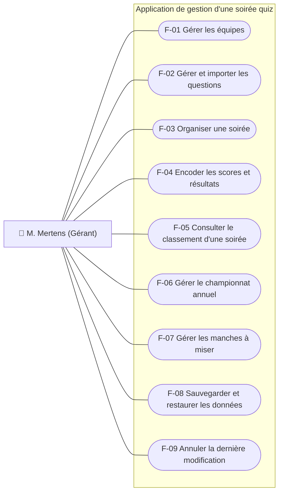

L’intelligence artificielle a été utilisée comme outil d’assistance pour contribuer à la reformulation de certaines phrases, dans le but d’améliorer la clarté et la cohérence du document.

* **Identification de l'acteur :** Sur le diagramme, un seul acteur est représenté : M. Mertens. Les équipes et les capitaines participent au quiz sur papier et échangent directement avec lui. Comme le programme fonctionne sur l'ordinateur du café et que seul M. Mertens l'utilise, il est donc le seul acteur qui interagit directement avec le système informatique.
* **Délimitation du système :** Le cadre autour du diagramme représente les limites de l'application que nous devons développer. Powerpoint et clés USB sont considérés comme des outils externes. Ils ne sont donc pas représentés comme des acteurs du système.
* **Nommage et organisation des cas d'utilisation :** Les cas d'utilisation sont formulés avec des verbes à l'infinitif afin de bien montrer les actions réalisées par l'utilisateur. Ils font également référence aux éléments du cahier des charges grâce à leur numéro (F-xx).